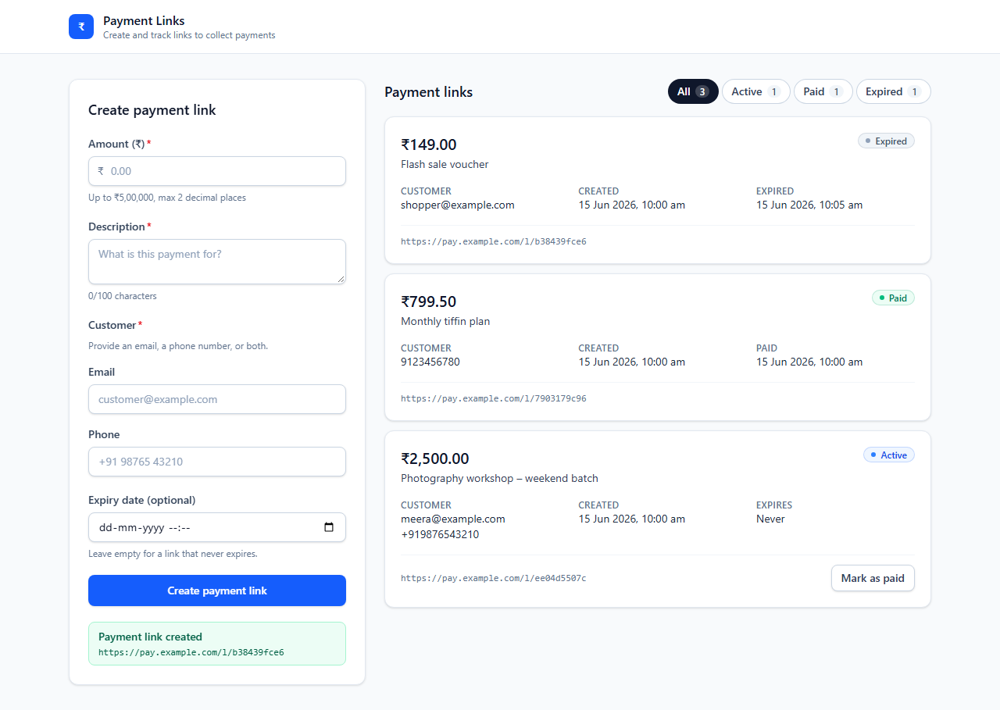
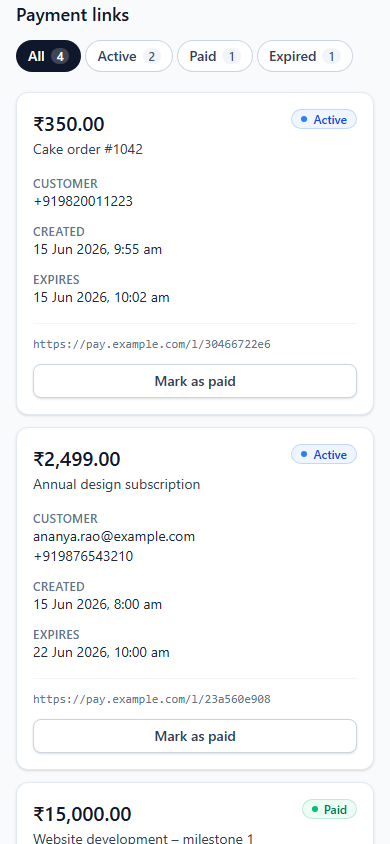

# Payment Links Manager

A responsive merchant dashboard for creating payment links, tracking them, and filtering them by status (Active, Paid, Expired). It's built with React 19, TypeScript, Vite and Tailwind CSS, and tested with Vitest, React Testing Library and Playwright.

There's no backend. Data lives in an in-memory mock API with a small simulated latency, and it resets on page reload.

## Getting started

```bash
npm install
npx playwright install chromium   # one-time, for E2E tests
npm run dev
```

To see every status right away, click **Load sample links** in the empty dashboard. One sample link expires two minutes after loading, so you can watch it change from Active to Expired on its own.

## Features

- **Create form**: amount (more than ₹0, at most ₹5,00,000, up to 2 decimal places), description (required, at most 100 characters), customer email and/or phone (at least one, format-checked), and an optional expiry that must be in the future.
- **Dashboard**: shows amount, description, customer, status, created time, expiry or paid time, and the link URL, newest first.
- **Status filter**: All / Active / Paid / Expired, each with a live count.
- **Automatic expiry**: links turn Expired as soon as their expiry passes, with no reload.
- **Mark as paid**: simulates a customer paying an Active link.
- **App states**: inline field errors, a loading skeleton, a load error with retry, a submit error, an empty dashboard, and an empty result for each filter.
- **Accessibility**: every field has a label; errors are linked with `aria-describedby` and `aria-invalid`; focus moves to the first invalid field after a failed submit; success is announced in a live region; filter buttons use `aria-pressed`; there's a skip link and visible focus rings.

## Design decisions

- **Expired is derived, not stored.** A link stores only `active` or `paid`. `getLinkStatus(link, now)` reports `expired` once `now >= expiresAt`, and a `useNow` hook re-renders every second. So the list, filters and counts always agree, and no background job has to flip status fields. A paid link never expires.
- **Money is stored as integer paise.** Amounts are parsed from the input string without floating-point maths, so `0.29` becomes exactly 29 paise.
- **The API boundary is injectable.** The UI uses the `PaymentLinksApi` interface. The default implementation is in-memory. Tests pass their own instance, for example a failing one to check the error state. A real HTTP client could replace it without UI changes.
- **Domain logic is pure.** Validation, status, filtering and formatting live in `src/domain/` with no React code, so they are easy to unit-test.

## Project layout

```
src/
  domain/        pure business logic: types, status, validation, formatting (+ unit tests)
  api/           PaymentLinksApi interface and in-memory mock implementation
  hooks/         usePaymentLinks (load/error/mutations), useNow (ticking clock)
  components/    CreateLinkForm, LinksDashboard, LinkCard, StatusBadge, FormField
  App.tsx        layout and wiring (+ component tests in App.test.tsx)
e2e/             Playwright specs
```

## Scripts

| Script                  | What it does                                      |
| ----------------------- | ------------------------------------------------- |
| `npm run dev`           | Start the Vite dev server                         |
| `npm run build`         | Type-check and build for production               |
| `npm run preview`       | Serve the production build                        |
| `npm run typecheck`     | Type-check only                                   |
| `npm run lint`          | Lint with oxlint                                  |
| `npm test`              | Run unit/component tests in watch mode (Vitest)   |
| `npm run test:run`      | Run unit/component tests once                     |
| `npm run test:coverage` | Run unit tests with V8 coverage                   |
| `npm run test:e2e`      | Run Playwright E2E tests (builds + previews app)  |
| `npm run test:e2e:ui`   | Open the Playwright UI runner                     |
| `npm run screenshots`   | Browser walkthrough; writes `docs/screenshots/`   |

## Tests

- `src/domain/validation.test.ts`: amount, description, contact, expiry rules and exact paise conversion.
- `src/domain/paymentLink.test.ts`: status derivation (including the expiry boundary and the rule that paid links never expire), filtering and counts.
- `src/App.test.tsx`: loading, empty and error/retry states; validation messages and focus; create; filter; mark as paid.
- `e2e/payment-links.spec.ts`: two tests. The first is the create-then-filter happy path. The second checks automatic expiry using Playwright's clock.

### Screenshot walkthrough

`npm run screenshots` runs `e2e/walkthrough.shot.ts` in Chromium against the production build. The walkthrough covers loading, empty state, validation, create, mark as paid, automatic expiry, every filter, keyboard navigation and the mobile layout. It checks each step before saving a screenshot to [`docs/screenshots/`](docs/screenshots/). Time is frozen with `page.clock`, so the dates in the images are the same on every run. The walkthrough uses its own config (`playwright.screenshots.config.ts`), so `npm run test:e2e` doesn't run it.

| All statuses (auto-expired link included) | Mobile |
| --- | --- |
|  |  |

### Troubleshooting (Windows)

If Vitest fails with *"Vitest failed to find the current suite"*, your shell's working directory probably has a lowercase drive letter (`c:\…`). This makes Vitest load twice. Run the tests from a path that starts with an uppercase `C:\`, for example `cd C:\Users\…\razorpay-interview`.
