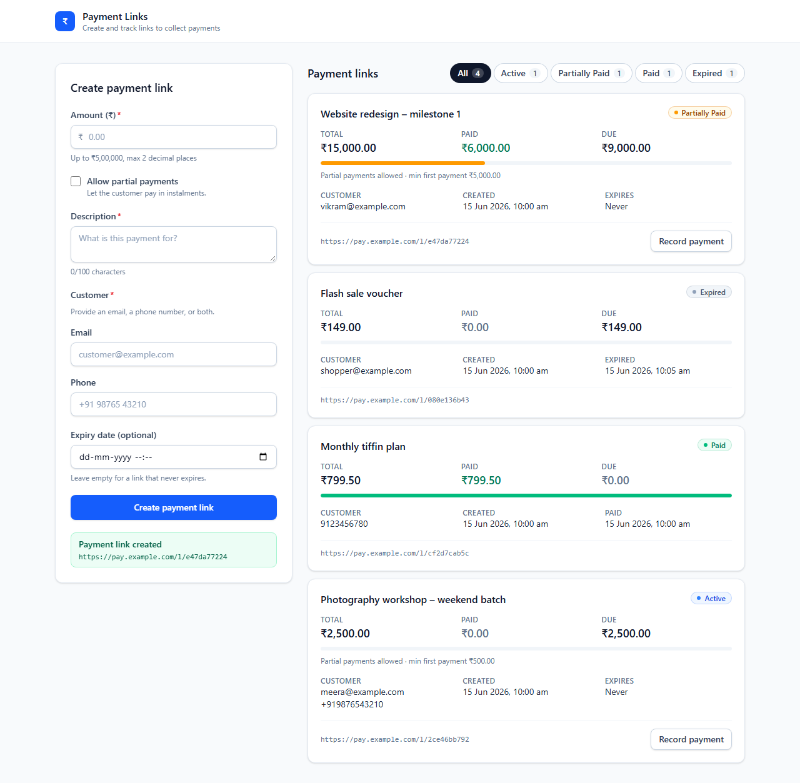
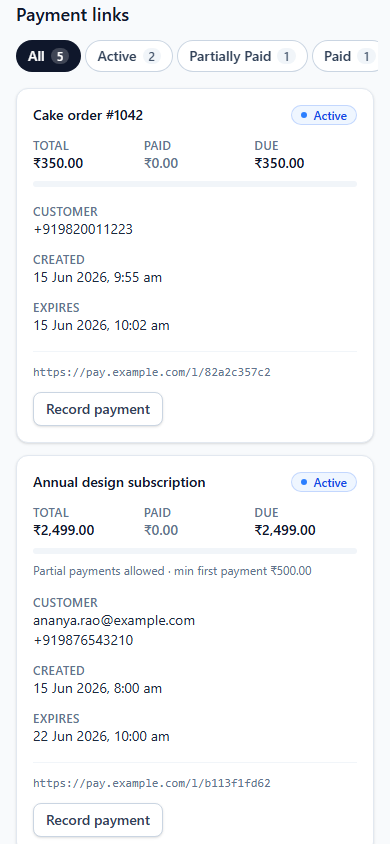

# Payment Links Manager

A responsive merchant dashboard for creating payment links, recording full or partial payments against them, and filtering them by status (Active, Partially Paid, Paid, Expired). It's built with React 19, TypeScript, Vite and Tailwind CSS, and tested with Vitest, React Testing Library and Playwright.

There's no backend. Data lives in an in-memory mock API with a small simulated latency, and it's saved to `localStorage`, so links and payments survive a page reload.

## Getting started

```bash
npm install
npx playwright install chromium   # one-time, for E2E tests
npm run dev
```

To see every status right away, click **Load sample links** in the empty dashboard. One sample link expires two minutes after loading, so you can watch it change from Active to Expired on its own. To start over, clear the `payment-links-manager` key in your browser's local storage.

## Features

- **Create form**: amount (more than ₹0, at most ₹5,00,000, up to 2 decimal places), description (required, at most 100 characters), customer email and/or phone (at least one, format-checked), and an optional expiry that must be in the future. Ticking **Allow partial payments** reveals a required **Minimum first payment** (more than ₹0, no more than the total).
- **Dashboard**: each card shows Total / Paid / Due with a progress bar, description, customer, status, created time, expiry or paid time, the partial-payment terms and the link URL, newest first.
- **Record payment**: an inline form on Active and Partially Paid links, prefilled with the minimum first payment or the amount due. Invalid amounts show an inline error and change nothing.
- **Status filter**: All / Active / Partially Paid / Paid / Expired, each with a live count.
- **Automatic expiry**: links turn Expired as soon as their expiry passes, with no reload.
- **Persistence**: links and payments are kept in `localStorage` and restored on reload.
- **App states**: inline field errors, a loading skeleton, a load error with retry, a submit error, an empty dashboard, and an empty result for each filter.
- **Accessibility**: every field has a label; errors are linked with `aria-describedby` and `aria-invalid`; focus moves to the first invalid field after a failed submit, and back to the card after recording a payment; success is announced in a live region; filter buttons use `aria-pressed`; there's a skip link and visible focus rings.

## Design decisions

- **Status is derived, not stored.** A link stores its total, expiry and a list of `payments`. `getLinkStatus(link, now)` derives the status in priority order: **Paid** (nothing due; a paid link never expires) > **Expired** (`now >= expiresAt`) > **Partially Paid** (something paid) > **Active**. A `useNow` hook re-renders every second, so the list, filters and counts always agree, and no background job has to flip status fields.
- **Payments are a list, not a flag.** Paid and Due are sums over `payments`, and the paid time is the time of the settling payment. Rules live in `src/domain/payment.ts`: only Active / Partially Paid links accept payments; an amount must be more than ₹0 and no more than the amount due; with partial payments off it must settle the full amount; with them on, the first payment must meet the minimum (later ones can be any amount up to the balance). The mock API applies the same rules, so the UI and "server" can't disagree.
- **Persistence is versioned and fails safe.** `src/api/storage.ts` saves `{ version: 1, links }` under the `payment-links-manager` key. On load, missing data, bad JSON, an unknown version, malformed links or storage throwing all fall back to an empty list instead of crashing. Write failures (private mode, full quota) are ignored, and the app keeps working in memory.
- **Money is stored as integer paise.** Amounts are parsed from the input string without floating-point maths, so `0.29` becomes exactly 29 paise.
- **The API boundary is injectable.** The UI uses the `PaymentLinksApi` interface. The default implementation is in-memory. Tests pass their own instance, for example a failing one to check the error state. A real HTTP client could replace it without UI changes.
- **Domain logic is pure.** Validation, status, filtering and formatting live in `src/domain/` with no React code, so they are easy to unit-test.

## Project layout

```
src/
  domain/        pure business logic (+ unit tests)
    paymentLink.ts   types, balances, status derivation, filtering and counts
    payment.ts       payment rules, recordPayment, suggested amount
    validation.ts    create-form validation and money parsing
    format.ts        currency and date formatting
  api/
    paymentLinksApi.ts   PaymentLinksApi interface and in-memory mock implementation
    storage.ts           versioned localStorage load/save with safe fallback
  hooks/         usePaymentLinks (load/error/mutations), useNow (ticking clock)
  components/    CreateLinkForm, LinksDashboard, LinkCard, RecordPaymentForm, StatusBadge, FormField
  App.tsx        layout and wiring (+ component tests in App.test.tsx)
e2e/             Playwright specs
```

## Scripts

| Script                  | What it does                                      |
| ----------------------- | ------------------------------------------------- |
| `npm run dev`           | Start the Vite dev server                         |
| `npm run build`         | Type-check and build for production               |
| `npm run preview`       | Serve the production build                        |
| `npm run typecheck`     | Type-check only                                   |
| `npm run lint`          | Lint with oxlint                                  |
| `npm test`              | Run unit/component tests in watch mode (Vitest)   |
| `npm run test:run`      | Run unit/component tests once                     |
| `npm run test:coverage` | Run unit tests with V8 coverage                   |
| `npm run test:e2e`      | Run Playwright E2E tests (builds + previews app)  |
| `npm run test:e2e:ui`   | Open the Playwright UI runner                     |
| `npm run screenshots`   | Browser walkthrough; writes `docs/screenshots/`   |

## Tests

- `src/domain/validation.test.ts`: amount, description, contact, expiry and minimum-first-payment rules, and exact paise conversion.
- `src/domain/paymentLink.test.ts`: balances, status derivation and priority (expiry boundary, Partially Paid links expiring, paid links never expiring), filtering and counts.
- `src/domain/payment.test.ts`: payment rules (amount due, full payment when partial is off, first-payment minimum), `recordPayment` and the suggested amount.
- `src/api/paymentLinksApi.test.ts`: create, record payment (and its rejections), sample links, and persistence: reload via shared storage, storage that throws on read or write, no storage.
- `src/App.test.tsx`: loading, empty and error/retry states; validation messages and focus; create; filter; the partial-payment field; recording partial and full payments and their inline errors.
- `e2e/payment-links.spec.ts`: six tests in a real browser: create-then-filter, automatic expiry, partial payments (below minimum, above due, settling to Paid, full payment required when partial is off), filtering across every status with counts, persistence across `page.reload()`, and status priority (a Partially Paid link expires, a Paid one doesn't) using Playwright's clock.

### Screenshot walkthrough

`npm run screenshots` runs `e2e/walkthrough.shot.ts` in Chromium against the production build. The walkthrough covers loading, empty state, validation (including the minimum first payment), create, recording partial and full payments with their errors, automatic expiry, every filter, persistence after a reload, keyboard navigation and the mobile layout. It checks each step before saving a screenshot to [`docs/screenshots/`](docs/screenshots/). Time is frozen with `page.clock`, so the dates in the images are the same on every run. The walkthrough uses its own config (`playwright.screenshots.config.ts`), so `npm run test:e2e` doesn't run it.

| All statuses (auto-expired link included) | Mobile |
| --- | --- |
|  |  |

### Troubleshooting (Windows)

If Vitest fails with *"Vitest failed to find the current suite"*, your shell's working directory probably has a lowercase drive letter (`c:\…`). This makes Vitest load twice. Run the tests from a path that starts with an uppercase `C:\`, for example `cd C:\Users\…\razorpay-interview`.
